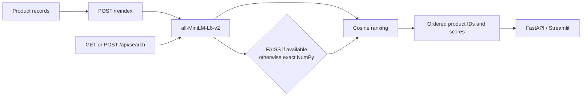

# Local Semantic Search Server

FastAPI and Streamlit reference service for embedding product text with the checked-in `all-MiniLM-L6-v2` SentenceTransformer model and ranking records by cosine similarity.

> Status: verified local reference implementation. The included model and exact NumPy index fallback run on CPU. FAISS is optional for larger indexes. This repository does not claim production-scale latency, multi-tenant authorization, or a hosted search service.

.png>)

## What actually runs

- FastAPI ASGI application exported as `app:app`.
- Local SentenceTransformer loading with warmup and model-dimension detection.
- FAISS index when available, otherwise an exact persisted NumPy cosine-search index.
- Bounded query length and `topk` validation.
- `/api/reindex` and `/reindex` for local product fixtures.
- `/api/search`, `/api/embeddings`, and `/api/health` endpoints.
- Streamlit operator UI through `streamlit run app.py`.
- Atomic JSON/index persistence under the ignored `index/` runtime directory.

## Architecture and data flow



The NumPy fallback is intentionally exact and suitable for local or small indexes. It is not presented as an HNSW or distributed-search implementation.

## Quick start

```powershell
py -3.12 -m venv .venv
.\.venv\Scripts\Activate.ps1
python -m pip install -r requirements.txt
uvicorn app:app --host 127.0.0.1 --port 9000
```

Open <http://127.0.0.1:9000/docs>. The health endpoint is <http://127.0.0.1:9000/api/health>.

The Streamlit UI is optional:

```powershell
streamlit run app.py
```

## Reproducible local search

Index three local records:

```powershell
curl.exe -X POST http://127.0.0.1:9000/reindex `
  -H "Content-Type: application/json" `
  -d '[{"product_id":"1","text":"wireless Bluetooth headphones with noise cancellation"},{"product_id":"2","text":"gaming mechanical keyboard with RGB lighting"},{"product_id":"3","text":"smartphone with a high-resolution camera and 5G"}]'
```

Query the persisted index:

```powershell
curl.exe "http://127.0.0.1:9000/api/search?q=wireless%20headphones&topk=3"
```

The reindex and search routes are intended for local fixtures. Add authentication, rate limiting, tenant isolation, and a reviewed persistence store before exposing them beyond a trusted development environment.

## Measured local evidence

On 2026-11-23, the checked-in MiniLM model loaded on CPU with dimension `384`. A two-record local fixture was encoded through the NumPy fallback; the query `wireless headphones` ranked `p1` at cosine score `0.9394` above `p2` at `0.5778`. This is a smoke demonstration, not a benchmark or a quality evaluation over a representative corpus.

The persisted model is `model/all-MiniLM-L6-v2`. The source records used for the smoke run were local synthetic product descriptions; no customer data was involved.

## Validation

```powershell
py -3.12 -m compileall -q app.py
py -3.12 -m pytest -q
```

The tests cover deterministic NumPy-index ordering, persistence, and bounded `topk` validation. GitHub Actions repeats dependency installation, compilation, and the tests on Python 3.12.

## Configuration and security

Start from [`.env.example`](.env.example). Never commit `.env` or credentials. The current tree contains no live API key, but repository history previously contained a non-empty `API_KEY`; revoke and rotate that credential with its issuing service before any deployment. History was not rewritten.

Runtime index files, manifests, tombstones, logs, caches, and local environments are intentionally ignored. The Procfile uses the real ASGI export:

```text
web: uvicorn app:app --host 0.0.0.0 --port $PORT --workers 1 --timeout-keep-alive 30
```
